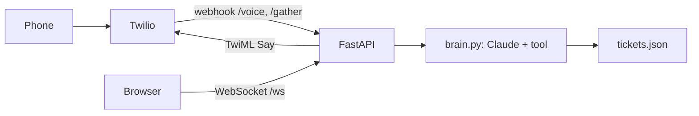

# Voice agent write-up

## 1. What I built
A voice support agent for a made-up product (Acme Cloud Backup). A caller asks about a ticket or a how-to question, Claude decides whether to call a `get_ticket_status` tool against synthetic data, and the reply is spoken back. It runs two ways: a browser version over a WebSocket, and a real phone call through Twilio webhooks. Both use the same `brain.answer(text)` function.

## 2. Diagram

## 3. Latency (browser, 10 turns from `logs/turns.jsonl`)
| # | Channel | Input | LLM ms | TTS ms | Total ms |
|---|---|---|---|---|---|
| 1 | ws | what is the status of ticket 1042 | 1929 | 363 | 2292 |
| 2 | ws | status of ticket 1045 | 2013 | 184 | 2197 |
| 3 | ws | check ticket 1048 please | 1962 | 306 | 2268 |
| 4 | ws | what about ticket 1050 | 1891 | 205 | 2096 |
| 5 | ws | status of ticket 1049 | 2351 | 212 | 2563 |
| 6 | ws | how do I restore a deleted folder | 1292 | 197 | 1489 |
| 7 | ws | how do I add a second device | 1293 | 220 | 1513 |
| 8 | ws | how do I change my backup schedule | 1136 | 202 | 1338 |
| 9 | ws | how do I reset my password | 1229 | 217 | 1446 |
| 10 | ws | how do I pause a backup | 1209 | 222 | 1431 |

Ticket lookups averaged 2029 ms of LLM time and how-to questions about 1.2 s. The LLM stage is the slowest. A ticket lookup needs two model calls (one to request the tool, one to write the answer), so it takes about 800 ms longer than a how-to question.

Caveat: the TTS column is not real speech time. My ElevenLabs key had a 10-credit cap, so each request failed fast with a quota error and the browser voice spoke instead. Those milliseconds measure the error. Speech recognition time was not measured on the server.

Phone turns (LLM stage only; Twilio handles recognition and speaking):
| # | Channel | Input | LLM ms | TTS ms | Total ms |
|---|---|---|---|---|---|
| 1 | phone | 99999 | 1982 | - | 1982 |
| 2 | phone | How about 1042? | 2124 | - | 2124 |
| 3 | phone | Ok, thank you. | 810 | - | 810 |
| 4 | phone | It's all good. Thank you. | 923 | - | 923 |

## 4. Three failures and fixes
1. **TTS quota crashed the WebSocket.** ElevenLabs returned `quota_exceeded` (key cap of 10 credits, reply needed 17 to 25). The exception killed the socket and the turn was never logged. Found by reading the uvicorn traceback. Fix: wrap TTS in try/except and fall back to the browser voice.
2. **Phone call ended after about 12 seconds with no reply.** Twilio reached `/voice` (200 in the server log) but no `/gather` request followed. The default listening window was too short. Fix: `timeout=10` and `barge_in=True` on `<Gather>`. After that the full call worked.
3. **Twilio blocked the call in several different ways.** Australia was disabled in Geo permissions, then the account needed identity verification (KYC), then the trial number was released on upgrade, and one auth token had a stray leading character (33 characters instead of 32). The Voice Logs also looked empty because the console was set to the AU region while API calls went to US1. Each had a different error message, and the server log plus the Twilio API told me which side the problem was on.

Also seen: speech recognition heard "9999" as "99999". The agent still said the ticket was not found and asked me to repeat it, instead of inventing an answer.

## 4b. Break-it tests (browser WebSocket)
| Test | What happened | Fix |
|---|---|---|
| Close the socket mid-reply | The turn vanished from `turns.jsonl`. `log_turn()` ran after TTS, so a failed send skipped it. | Log in a `finally` block so every turn is recorded. |
| 2,000-word input | Capped at 500 chars, but I kept the start, so the question at the end was cut off and the agent answered the filler. | Keep the last 500 chars (`[-MAX_INPUT:]`). Now answers correctly (measured 2,411 ms in the turn log). |
| Two questions back to back | Replies came back in order (1043 then 1045). The loop handles one message at a time, so the second waits for the first. Fine for one caller. | None needed. |
| Ticket 9999 | "I couldn't find ticket 9999", with a request to repeat it. No invented answer. | None needed. |

## 5. SIP in four sentences
1. Initiation: The caller sends an INVITE request to start the session.
2. Provisional responses: The receiving end acknowledges receipt with 100 Trying, followed by 180 Ringing while the destination endpoint alerts the user.
3. Establishment: Once the call is accepted, the receiver responds with 200 OK, and the caller completes the handshake by sending an ACK.
4. Termination: Either party can end the call by sending a BYE message.

This SIP section is at concept level only. I have not built or run anything with SIP.
